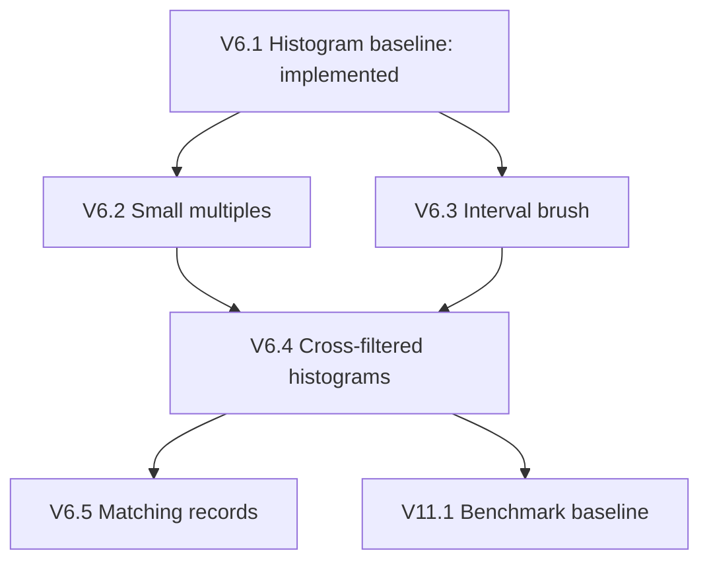

# Progress review and video-sized pull request DAG

Reviewed **2026-11-06** against main at [`77bf1fe`](https://github.com/vizhub-studio/constructing-visualizations/commit/77bf1fe). Change window: **2026-10-30 through 2026-11-06**. This is a dated baseline for subsequent Friday reviews, not a claim that an automation is active.

## Sources and interpretation

- [Updated course roadmap](UPDATED_COURSE_ROADMAP.md): chapter/example scopes used below.
- [Crossfilter stepladder](CROSSFILTERING_STEPLADDER.md): architecture refinements and stopping points.
- [Course outline](COURSE_OUTLINE.md): older 15-week Munzner-aligned teaching/assignment structure.
- [Example registry](../src/examples/index.ts), numbered source directories, dataset manifests, and Git history: implementation evidence.
- [Coding style](DATA_VISUALIZATION_CODING_STYLE.md), [agent guidance](../AGENTS.md), and [example creation instructions](../.pi/skills/example-creation/SKILL.md): acceptance criteria.
- [Reference examples](REFERENCE_EXAMPLES.md) and [playlist link in README](../README.md): supporting material, not proof of current implementation or video publication.

No explicit PR/video DAG was found in the tracked planning material. The DAG below **translates the existing roadmap into proposed PR/video units**; the scopes come from that roadmap, while dependency edges and delivery order are editorial proposals in this review. Chapter numbers refer to the updated roadmap, not the older course weeks or a verified textbook manuscript. No separate manuscript or complete episode-to-example index was available in this checkout. A merged example does not establish that its video was recorded or published.

## Confirmed progress

| Change                                                | Evidence                                                                                                                                                       | Coverage impact                                                                                                                  |
| ----------------------------------------------------- | -------------------------------------------------------------------------------------------------------------------------------------------------------------- | -------------------------------------------------------------------------------------------------------------------------------- |
| Added 020 Basic Histogram                             | [PR #46](https://github.com/vizhub-studio/constructing-visualizations/pull/46), merged Nov 5; [source](../src/examples/020-basic-histogram/BasicHistogram.tsx) | Adds a minimal static entry to roadmap 6.1 before interactive 019. Target 20 bins is approximate, not a guarantee of exactly 20. |
| Revised 020 during review                             | #46 final source preserves dataset rows/columns, names binValue and filteredData, configures ticks/gap, and uses a D3 renderMarks join                         | Makes the load → bin → scale → draw lesson easier to isolate. These refactors are already merged.                                |
| Extracted 020 local dimensions hook; documented style | [PR #47](https://github.com/vizhub-studio/constructing-visualizations/pull/47), merged Nov 5                                                                   | Establishes guidance for future examples, without completing any additional chapter example.                                     |
| Merged older “Add canvas content” branch              | [PR #25](https://github.com/vizhub-studio/constructing-visualizations/pull/25), merged Nov 5                                                                   | Its merge has no first-parent file diff. Do not count it as a newly implemented canvas lesson.                                   |

Earlier baseline, **outside this review window**: 013 interactive legend, 014 menus, 015 explorer, 016 species bars ([#40](https://github.com/vizhub-studio/constructing-visualizations/pull/40)), 017 scatter + bars ([#41](https://github.com/vizhub-studio/constructing-visualizations/pull/41)), 018 brush scatter → bars ([#43](https://github.com/vizhub-studio/constructing-visualizations/pull/43)), and 019 dynamic histogram ([#44](https://github.com/vizhub-studio/constructing-visualizations/pull/44)) are present on main. There are 20 registered numbered examples, 001–020.

## Unresolved work, gaps, and blockers

**PR queue:** GitHub returned no open PRs at review time, before this documentation PR. [#45](https://github.com/vizhub-studio/constructing-visualizations/pull/45) is closed without merge and superseded by #46; its requested full-row parsing/accessor refactors should not be carried forward as outstanding. #42 is also closed without merge; the brushing implementation landed through #43.

**Bin-boundary claim needs reconciliation:** #46's description says bounds are runtime-validated. Final `BasicHistogram.tsx` filters finite measurements but casts D3's result to `HistogramBin[]`; `renderMarks.ts` defines that type with required x0/x1. There is no explicit runtime boundary guard in the final version. Decide whether to document the D3 invariant or add a small boundary check; do not report the earlier guard as still present. Also assess narrow-container geometry: the direct bar-width expression can become negative when a bin is narrower than the one-pixel gap. These are review findings, not observed browser failures.

**Coverage gap:** 020 improves the first histogram lesson; it does not implement small multiples, interval brushing, generalized cross-filtering, or a matching-records table. No numbered examples beyond 020 exist. Pseudo bar/line examples 002–003 are not evidence that the real-data composition/time-series roadmap is complete.

**Source alignment:** the older outline places spatial data in week 7, networks in week 8, and multiple views in week 11; the updated roadmap uses chapters 8, 9, and 12 respectively. Keep those labels distinct until an editorial reconciliation. The README only enumerates early episodes; video publication status for the nodes below is unverified.

**Data gates:** Penguins, Pew, ATUS, Star Wars, ACS migration, county boundaries, and NPM dataset directories exist. Existence is not proof of fitness or completeness. No dedicated Migrant Deaths dataset directory was found, despite the roadmap describing it as available. BTS airport data exists but does not by itself establish a global airport route network. Before geographic/semantic work, verify incident source/license/schema, world/state geometry, route endpoints, hierarchy choice, and reproducible embedding/UMAP artifacts. Select the line-chart dataset and server backend before their respective PRs; these decisions do not block Penguins work.

## Chapter coverage

| Updated roadmap                   | Confirmed implementation                                                     | Remaining coverage                                                                         |
| --------------------------------- | ---------------------------------------------------------------------------- | ------------------------------------------------------------------------------------------ |
| 5: Penguins                       | 013–018 cover legend, menus, aggregation, shared views, and scatter brushing | Review/record the teaching sequence; do not recreate these examples.                       |
| 6: Distributions                  | 019 interactive and 020 basic histogram cover 6.1                            | 6.2–6.5 are missing. Teach 020 before 019 despite numeric order.                           |
| 7: Composition/time               | Foundational pseudo charts only                                              | 7.1–7.7: real-data grouped/stacked/normalized bars, lines, temporal tooltip, streamgraph.  |
| 8–9: Geography/relationships      | Supporting datasets and historical references                                | All numbered roadmap examples remain planned.                                              |
| 10: Perceptual encoding           | Categorical color in Penguins                                                | Dedicated laboratories and choropleth color lesson remain planned.                         |
| 11: Scaling                       | Stepladder prose; local throttling exists in 018                             | No dedicated benchmark, worker, or server example.                                         |
| 12: Exploratory applications      | 017–018 establish coordination prerequisites                                 | Three flagship explorers remain planned.                                                   |
| 13–14: Embeddings/focus + context | Existing scatter/interaction foundations                                     | Embedding preparation, semantic views, navigation, and semantic zoom remain planned.       |
| 15: Integration                   | Coding conventions now documented                                            | Dataset-to-system lesson, mature-app refactor, and architecture comparison remain planned. |

## DAG contract

Each `Vx.y` is one **proposed PR and corresponding video**, titled from roadmap Example x.y. These are planning IDs, not GitHub PR numbers, recording order, or reserved source-directory numbers. For implemented nodes, the table records existing code instead of proposing duplicate PRs. Video status for every node is **unverified**. For planned nodes, the title is the proposed video title; the scope states the demonstration the PR must make possible.

The dependency table is the complete adjacency list: all listed predecessors must be available before the node is ready. An empty predecessor list means no remaining roadmap-node prerequisite, not that data acquisition or basic React/D3 knowledge is unnecessary. Edges describe lesson/implementation prerequisites, **never cross-example imports**. Some are teaching choices, e.g. county arcs before airport arcs and Migrant Deaths before the NPM adaptation; they may be revised explicitly. The selected capstone path uses Migrant Deaths Explorer, though the roadmap allows another mature explorer.

The near-term branching is:

## Complete roadmap PR/video inventory

Scope details remain in the linked roadmap sections; optional extensions there are not automatically required for the first video. All rows marked Planned have no implementation PR assigned at this snapshot.

| Node  | PR / video topic                                               | Predecessors        | Code status / remaining scope                                                                                                          |
| ----- | -------------------------------------------------------------- | ------------------- | -------------------------------------------------------------------------------------------------------------------------------------- |
| V5.1  | Penguins: color + interactive legend (roadmap 5.1)             | —                   | Implemented: 013 interactive color legend.                                                                                             |
| V5.2  | Configurable scatter plot (roadmap 5.2)                        | V5.1                | Implemented: 014 menus and 015 explorer.                                                                                               |
| V5.3  | Species bar chart (roadmap 5.3)                                | —                   | Implemented: 016 species bar chart.                                                                                                    |
| V5.4  | Scatter plot + bar chart (roadmap 5.4)                         | V5.2, V5.3          | Implemented: 017 scatter plot and bar chart.                                                                                           |
| V5.5  | Brush scatter → aggregate bars (roadmap 5.5)                   | V5.4                | Implemented: 018 brush scatter to bars.                                                                                                |
| V6.1  | Single histogram (roadmap 6.1)                                 | —                   | Implemented: 020 basic baseline plus 019 interactive histogram; reconcile boundary claim above.                                        |
| V6.2  | Small multiples of histograms (roadmap 6.2)                    | V6.1                | Planned: Reuse a local histogram component across four Penguins measurements; keep comparable layout and explicit field configuration. |
| V6.3  | Brush one histogram (roadmap 6.3)                              | V6.1                | Planned: Convert a one-dimensional brush through scale.invert to a numeric predicate; clear restores all rows.                         |
| V6.4  | Cross-filtered histogram small multiples (roadmap 6.4)         | V6.2, V6.3          | Planned: Combine active filters with AND; brushing one view updates the other distributions; define self-filter behavior.              |
| V6.5  | Filtered records table (roadmap 6.5)                           | V6.4                | Planned: Show the first 20 matching rows and total match count without truncating the filtered dataset.                                |
| V7.1  | Grouped bar chart (roadmap 7.1)                                | V5.3                | Planned: Pew country/religion groups with nested band scales and legend.                                                               |
| V7.2  | Stacked bar chart (roadmap 7.2)                                | V7.1                | Planned: Reuse the grouped table with d3.stack; explain cumulative positions.                                                          |
| V7.3  | 100% stacked bars (roadmap 7.3)                                | V7.2                | Planned: Normalize country totals to 100%; distinguish absolute values from shares.                                                    |
| V7.4  | Single line chart (roadmap 7.4)                                | —                   | Planned: Select a time-series dataset; parse dates, sort, and handle missing observations.                                             |
| V7.5  | Multiple-line chart (roadmap 7.5)                              | V7.4                | Planned: Group time series into colored paths and support series highlighting.                                                         |
| V7.6  | Quantized Voronoi tooltip for multiple lines (roadmap 7.6)     | V7.5                | Planned: Quantize pointer time, find nearest candidate series, and display its observation.                                            |
| V7.7  | American Time Use streamgraph (roadmap 7.7)                    | V7.2, V7.5          | Planned: Use ATUS to compare zero-baseline stacked area with streamgraph offset.                                                       |
| V8.1  | Geographic foundations (roadmap 8.1)                           | —                   | Planned: Choose geographic geometry and render projected polygons.                                                                     |
| V8.2  | Basic choropleth (roadmap 8.2)                                 | V8.1                | Planned: Join region keys to a normalized measure and encode missing values explicitly.                                                |
| V8.3  | Migrant Deaths point map (roadmap 8.3)                         | V8.1                | Planned: Acquire incident records, validate coordinates, encode magnitude, and show record tooltips.                                   |
| V8.4  | Time histogram below the map (roadmap 8.4)                     | V8.3, V6.1          | Planned: Aggregate incidents or deaths by time; label the chosen measure and interval.                                                 |
| V8.5  | Brush time → update map (roadmap 8.5)                          | V8.4, V6.3          | Planned: Brush the time histogram to filter map incidents and update totals.                                                           |
| V9.1  | Force-directed Star Wars network (roadmap 9.1)                 | —                   | Planned: Load Star Wars nodes/links and run a force simulation.                                                                        |
| V9.2  | Interactive Star Wars network (roadmap 9.2)                    | V9.1                | Planned: Neighbor highlighting, persistent selection, tooltips, and edge-weight filtering.                                             |
| V9.3  | Star Wars adjacency matrix with Reorder.js (roadmap 9.3)       | V9.1                | Planned: Build an adjacency matrix and compare Reorder.js ordering strategies.                                                         |
| V9.4  | American Community Survey county migration flows (roadmap 9.4) | V8.2                | Planned: Join county migration flows to county geography and establish origin/destination semantics.                                   |
| V9.5  | Click county → migration arcs (roadmap 9.5)                    | V9.4                | Planned: Select a county and draw ranked incoming/outgoing arcs.                                                                       |
| V9.6  | Global airport network (roadmap 9.6)                           | V9.5                | Planned: Adapt flow selection to a verified global airports/routes dataset.                                                            |
| V9.7  | U.S. state choropleth (roadmap 9.7)                            | V8.2                | Planned: Join state measures to geography with an explicit legend.                                                                     |
| V9.8  | State → county drill-down (roadmap 9.8)                        | V9.7                | Planned: Select a state to show county detail and preserve navigation context.                                                         |
| V9.9  | Tidy node-link tree (roadmap 9.9)                              | —                   | Planned: Choose hierarchy data; introduce parent-child structure and tidy layout.                                                      |
| V9.10 | Cluster / dendrogram (roadmap 9.10)                            | V9.9                | Planned: Reuse hierarchy data in a cluster/dendrogram layout.                                                                          |
| V9.11 | Treemap (roadmap 9.11)                                         | V9.9                | Planned: Aggregate values into nested rectangles; explain area encoding.                                                               |
| V9.12 | Circle packing (roadmap 9.12)                                  | V9.9                | Planned: Compare nested circle packing against treemap space use.                                                                      |
| V9.13 | Icicle (roadmap 9.13)                                          | V9.9                | Planned: Render hierarchy depth as aligned rectangular partitions.                                                                     |
| V9.14 | Sunburst (roadmap 9.14)                                        | V9.13               | Planned: Translate partition layout to radial arcs.                                                                                    |
| V10.1 | Color-scale laboratory (roadmap 10.1)                          | V5.1                | Planned: Compare sequential, diverging, and categorical palettes.                                                                      |
| V10.2 | Choropleth color design (roadmap 10.2)                         | V10.1, V8.2         | Planned: Compare choropleth color/domain choices on the same data.                                                                     |
| V10.3 | Visual encoding laboratory (roadmap 10.3)                      | V10.1               | Planned: Compare visual channels while holding the underlying data constant.                                                           |
| V11.1 | Benchmark the baseline (roadmap 11.1)                          | V6.4                | Planned: Record filter, aggregation, render, and responsiveness timings at increasing row counts.                                      |
| V11.2 | Main-thread optimization (roadmap 11.2)                        | V11.1               | Planned: Optimize the measured bottleneck and retain before/after measurements.                                                        |
| V11.3 | Web Worker cross-filtering (roadmap 11.3)                      | V11.2               | Planned: Move filtering/aggregation to a worker with latest-wins scheduling and stale-result protection.                               |
| V11.4 | Server-side aggregation and filtering (roadmap 11.4)           | V11.3               | Planned: Return aggregates from a server/query layer; choose backend and deployment separately.                                        |
| V12.1 | Migrant Deaths Explorer (roadmap 12.1)                         | V8.5, V6.5          | Planned: Compose map, time filters, summaries, and records into the Migrant Deaths Explorer.                                           |
| V12.2 | County Migration Explorer (roadmap 12.2)                       | V9.5, V6.5          | Planned: Compose county selection, flows, summaries, and records into an explorer.                                                     |
| V12.3 | Global Airport Explorer (roadmap 12.3)                         | V9.6, V6.5          | Planned: Compose airport selection, routes, summaries, and filters into an explorer.                                                   |
| V13.1 | Migrant Deaths semantic scatter plot (roadmap 13.1)            | V8.3                | Planned: Prepare reproducible description embeddings and UMAP coordinates; render incident points.                                     |
| V13.2 | Zoomable embedding visualization (roadmap 13.2)                | V13.1               | Planned: Add zoom/pan; assess SVG versus canvas using measured point counts.                                                           |
| V13.3 | Tooltips on embedding points (roadmap 13.3)                    | V13.2               | Planned: Reconnect semantic points to descriptions and source metadata.                                                                |
| V13.4 | Clustering (roadmap 13.4)                                      | V13.1               | Planned: Assign clusters separately from UMAP coordinates and compare known categories.                                                |
| V13.5 | NPM semantic landscape (roadmap 13.5)                          | V13.3, V13.4        | Planned: Prepare NPM description embeddings; add zoom, selection, search, and download encoding.                                       |
| V13.6 | Semantic neighbors (roadmap 13.6)                              | V13.5               | Planned: Select a package and explain distances in original versus projected space.                                                    |
| V13.7 | Brush semantic space → derive summaries (roadmap 13.7)         | V13.5, V6.4         | Planned: Brush semantic points into shared filters and derived summaries.                                                              |
| V14.1 | Overview + detail time series (roadmap 14.1)                   | V7.5, V6.3          | Planned: Coordinate overview brushing with a detailed time-series view.                                                                |
| V14.2 | Zoomable hierarchy (roadmap 14.2)                              | V9.14               | Planned: Add zoom navigation to a hierarchy while retaining context.                                                                   |
| V14.3 | Semantic zoom in embeddings (roadmap 14.3)                     | V13.7               | Planned: Change embedding detail by zoom level: aggregates, points, then labels.                                                       |
| V15.1 | From unfamiliar dataset to visualization system (roadmap 15.1) | V12.1               | Planned: Work through domain questions, abstractions, encodings, and coordination on an unfamiliar dataset.                            |
| V15.2 | Refactor a substantial application (roadmap 15.2)              | V12.1               | Planned: Refactor one mature explorer into loading, transforms, filters, state, marks, and interaction modules.                        |
| V15.3 | The visualization architecture ladder (roadmap 15.3)           | V15.1, V15.2, V11.4 | Planned: Compare static, interactive, coordinated, and scalable architectures using working examples.                                  |

## Cross-filtering refinement videos

The roadmap's V11.2/V11.3 are deliberately broad. The existing [stepladder](CROSSFILTERING_STEPLADDER.md) can expand them into the following smaller PR/video units if one recording cannot explain the scope clearly. These are **optional decompositions**, not additional completed work or mandatory dependencies of every chapter. If adopted, update the parent node to reference the child PRs rather than count both as separate coverage.

| Node | One PR / video demonstration                                                     | Predecessors |
| ---- | -------------------------------------------------------------------------------- | ------------ |
| S01  | Local synchronous predicates (step 1; already the goal of V6.4)                  | V6.4         |
| S02  | Centralize filter state (step 2)                                                 | S01          |
| S03  | Throttle recomputation with measured before/after behavior (step 3)              | S02, V11.1   |
| S04  | Move filtering into a worker (step 4)                                            | S03          |
| S05  | Single-flight latest-wins scheduling (step 5)                                    | S04          |
| S06  | Return row indices instead of whole rows (step 6)                                | S05          |
| S07  | URL-sync committed filter state (step 7)                                         | S02          |
| S08  | Make URL state authoritative, retaining local brush preview (step 8)             | S07          |
| S09  | Worker-side aggregation (step 9)                                                 | S06          |
| S10  | Columnar worker storage (step 10)                                                | S09          |
| S11  | Per-dimension bitset masks (step 11)                                             | S10          |
| S12  | Sorted numeric indexes and binary search (step 12)                               | S11          |
| S13  | Encoded categorical buckets (step 13)                                            | S11          |
| S14  | Integrate the worker-side crossfilter engine (step 14)                           | S12, S13     |
| S15  | Combine router, worker, and preview state (step 15)                              | S08, S14     |
| S16A | Return only aggregates (step 16A; assess overlap with S09 first)                 | S09          |
| S16B | Supply filtered indices when needed (step 16B; assess overlap with S06 first)    | S09          |
| S16C | Transfer typed arrays (step 16C)                                                 | S10          |
| S16D | Ignore a view's own filter when computing its background distribution (step 16D) | S11          |
| S16E | Worker-side record paging (step 16E)                                             | S14, V6.5    |
| S16F | Update only changed dimensions (step 16F)                                        | S14          |

The stepladder's steps 17–19 describe stopping points and a target architecture, not additional feature PRs. Preserve its “good enough” stop after centralized filters, worker filtering, single-flight scheduling, and URL synchronization. Do not require the entire engine before recording basic cross-filtering.

## Suggested priorities and acceptance gates

1. **Reconcile and verify the histogram baseline.** Resolve the boundary-validation wording, check small-screen geometry, and confirm the intended teaching order 020 → 019. A focused PR/video titled “Histogram invariants and responsive geometry” is warranted only if code changes are needed; otherwise record the decision with V6.1.
2. **Deliver V6.2 and V6.3, then V6.4, then V6.5.** V6.2 and V6.3 can branch from the same baseline. These fill the most immediate chapter gap with data already in the repo. Use the next available example numbers at implementation time.
3. **Start V7.1 and V7.4 independently when ready.** Verify Pew schema and choose a time-series dataset. Follow their composition/time branches without waiting for advanced workers or geography.
4. **Clear data gates before V8/V9/V13.** Acquire and document missing assets, rather than treating historical VizHub references as checked-in examples. Benchmark only after a working coordinated baseline exists.
5. **Track publication independently.** For each implemented node add actual PR URL, example directory, validation SHA, video URL, and recorded/published dates when known. Never infer publication from merge status.

Every example PR should provide one reproducible demonstration, a self-contained numbered directory with local hooks, a dataset manifest, registry entry, and a short teaching narrative. Follow the style guide's full-data preservation, named accessors, null loading state, and React/D3 ownership rules. Run example validation, lint, build, formatting, and visual checks; record unavailable checks. Data/server/embedding work needs reproducibility instructions and prerequisites before claiming the lesson is ready.

This documentation PR is administrative and is not counted as a lesson/video node. Optional Flights Explorer, radial-tree variants, and optional interactions in the roadmap remain uncommitted extensions; do not silently promote them into the core DAG.

## Validation and next review procedure

At the reviewed main snapshot, after installing locked dependencies:

- `npm run validate:examples`: passed for all 20 examples (manifests/isolation readiness, not visual correctness).
- `npm run lint`: passed.
- `npm run build`: passed (TypeScript and Vite).
- No browser visual check or video-publication verification was performed. These passes are local results, not claims about CI or deployment.

For this documentation change, check formatting, relative links, node uniqueness, predecessor existence, and acyclicity. At the next review, compare main against the SHA above, inspect open/merged/closed PRs, map changed directories to roadmap nodes, and update code and video statuses separately. Keep confirmed changes, unresolved work, and suggested priorities distinct; preserve older dated snapshots when adding a new review.
